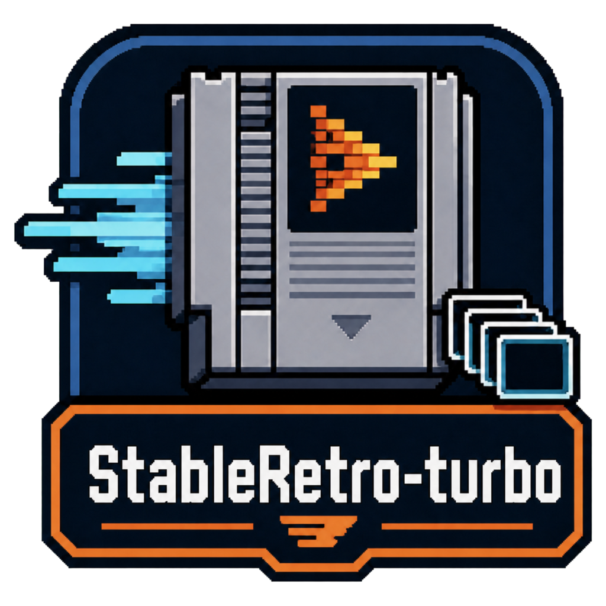

<p align="center">
  
  <br />
  <!-- repo-tagline:start -->
  <strong>🚀 Blazing-fast Stable Retro fork with native vectorization and preprocessing 🚀</strong>
  <!-- repo-tagline:end -->
</p>

Stable Retro Turbo provides Gymnasium-compatible retro game environments with
native vector execution and preprocessing. Use the `env_stableretro_turbo`
import and supply your own legally obtained ROMs.

## Quickstart

Release wheels require Python 3.14 on Apple silicon macOS or x86-64 Linux.

```bash
uv venv --python 3.14
source .venv/bin/activate
uv pip install env-stableretro-turbo
python -m env_stableretro_turbo.import /path/to/your/roms
env-stableretro-turbo play --list
```

The last command lists imported games. Run `env-stableretro-turbo play GAME_ID`
to open one. The [Turbo Vector API v2](docs/env-stableretro-turbo-guide.md#turbo-vector-api-v2)
explains vector observations, lane resets, and compatibility.

[Read the stable retro turbo user guide](docs/env-stableretro-turbo-guide.md) for the full reference.

## License

[MIT](LICENSE)
